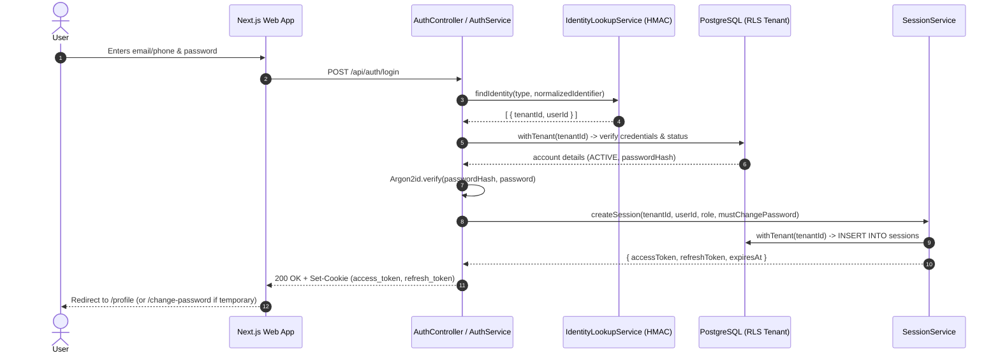
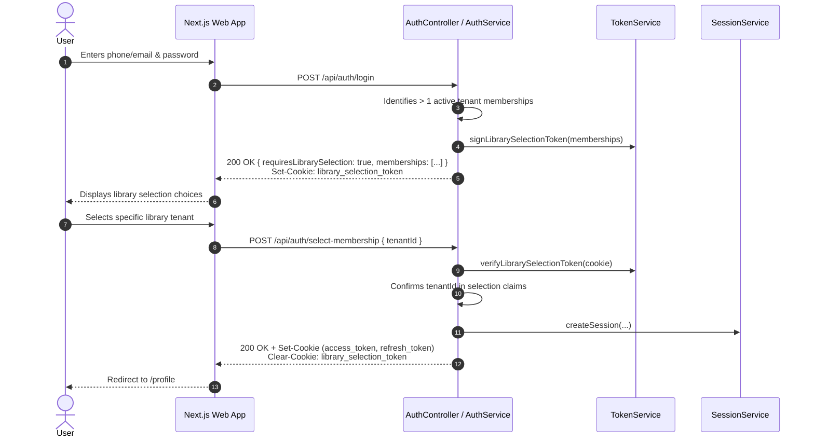
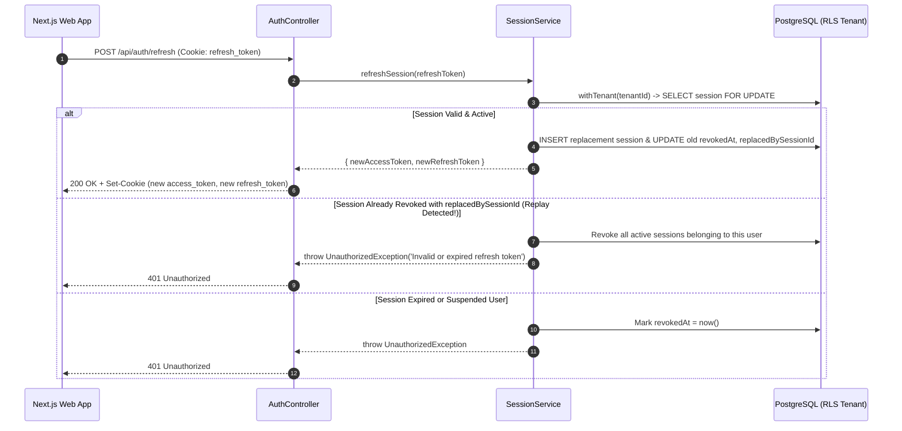
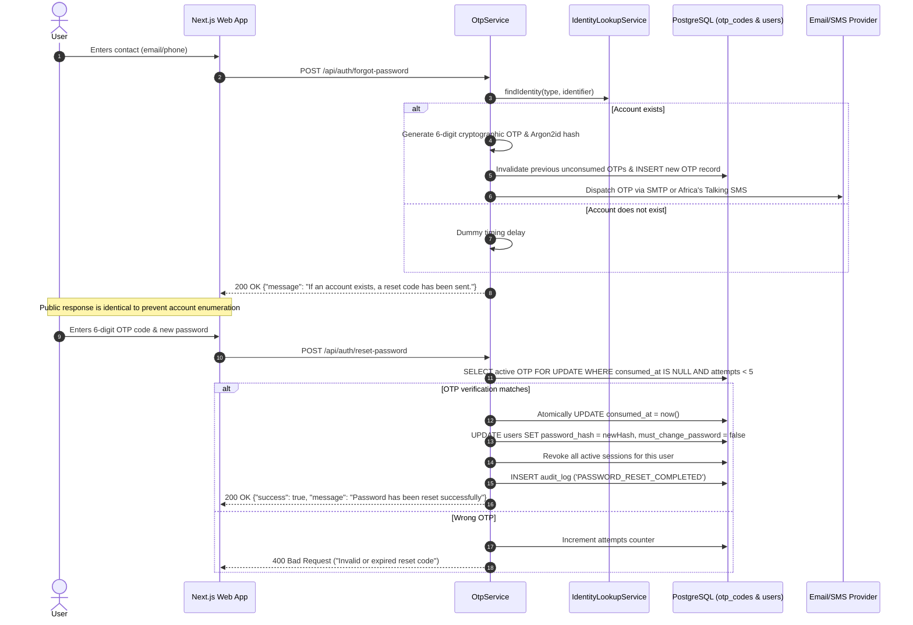

# Authentication Flows (v1.0 MVP)

This document describes the step-by-step authentication and credential lifecycle flows implemented in the LMS v1.0 platform.

---

## 1. Single-Library Login Flow (AUTH-1)

When a user signs in using an email address or Kenyan phone number that is registered with exactly one library tenant:

---

## 2. Multi-Library Selection Flow (AUTH-1)

When a patron or teacher is registered in multiple independent libraries under the same phone number or email:

---

## 3. Refresh-Token Rotation & Replay Protection (AUTH-5)

Access tokens expire after 15 minutes. The web client uses the HTTP-only refresh cookie (valid for 7 days) to obtain fresh tokens without re-authenticating:

---

## 4. Mandatory First-Login Password Change (AUTH-1, AUTH-4)

When an administrator or librarian creates an account, a temporary password is generated and `must_change_password` is set to `true`:

1. User logs in with temporary password.
2. Login response returns `user.mustChangePassword: true` and the access token carries `mustChangePassword: true`.
3. `AccessTokenGuard` inspects the flag:
   - Requests to normal application routes return **`403 Forbidden`** (`Password change required on first login`).
   - Only `/api/auth/change-password`, `/api/auth/logout`, and `/api/auth/sessions` are permitted.
4. User submits `POST /api/auth/change-password` with `currentPassword` and `newPassword`.
5. Upon successful change:
   - Password hash is replaced with the Argon2id hash of the new password.
   - `must_change_password` is cleared to `false`.
   - All other active sessions for that user are revoked.
   - An immutable audit record (`PASSWORD_CHANGED`) is appended.
   - Subsequent requests proceed normally.

---

## 5. Password Reset via Email or SMS OTP (AUTH-3)

---

## 6. Staff-Created Member Onboarding (AUTH-4)

- **Initiator**: ADMIN or LIBRARIAN.
- **Endpoint**: `POST /api/members`
- **Validation**: Member type belongs to actor's tenant, class/group belongs to actor's tenant, format checks for email/phone and identity documents.
- **Execution**:
  - Secure temporary password generated via `crypto.randomBytes(24).toString('base64url')`.
  - Identity document (national ID, passport, alien ID) encrypted using AES-256-GCM; lookup hash generated via HMAC-SHA-256.
  - User record created with `role = 'MEMBER'`, `status = 'ACTIVE'`, and `must_change_password = true`.
  - Profile record created with foreign keys scoped strictly to tenant.
  - Audit record created with action `MEMBER_CREATED` (without logging credentials or document values).
  - Temporary password returned **once** in the creation response to the staff member.

---

## 7. Staff-Created Librarian Onboarding (AUTH-4)

- **Initiator**: ADMIN only.
- **Endpoint**: `POST /api/users/librarians`
- **Validation**: Caller must hold role `ADMIN`. Target email/phone normalized and checked for duplicates within tenant.
- **Execution**:
  - Generates secure temporary password.
  - Hashes with Argon2id.
  - Inserts user with `role = 'LIBRARIAN'`, `status = 'ACTIVE'`, `must_change_password = true`.
  - Registers identity lookup records.
  - Appends audit log with action `LIBRARIAN_CREATED`.
  - Returns temporary password once in creation response.

---

## 8. Safe Account Deactivation (Section 4.5)

- **Initiator**: Self-service only (any authenticated non-guest user can deactivate their own account).
- **Endpoint**: `DELETE /api/profile`
- **Safeguards**:
  - **Last Active Admin Protection**: If current role is `ADMIN`, counts active admins in tenant inside transaction with row-level locks. If count ≤ 1, rejects with `Cannot deactivate the last active administrator`.
  - **Last Active Librarian Protection**: If current role is `LIBRARIAN`, counts active librarians in tenant inside transaction with row-level locks. If count ≤ 1, rejects with `Cannot deactivate the last active librarian`.
  - Soft deactivation only: updates `users.status = 'SUSPENDED'`. No rows are deleted.
  - All active sessions are immediately revoked.
  - Appends audit log with action `ACCOUNT_DEACTIVATED`.

---

## 9. Librarian Role Promotion (Section 4.6)

- **Initiator**: ADMIN only.
- **Endpoint**: `POST /api/users/:userId/promote`
- **Rules**:
  - Target user must belong to the caller's tenant.
  - Target must currently hold role `LIBRARIAN` and have status `ACTIVE`.
  - Self-promotion is strictly rejected.
  - Updates target user's role to `ADMIN`.
  - Appends audit log with action `ROLE_PROMOTED`, recording `oldRole: 'LIBRARIAN'` and `newRole: 'ADMIN'`.
